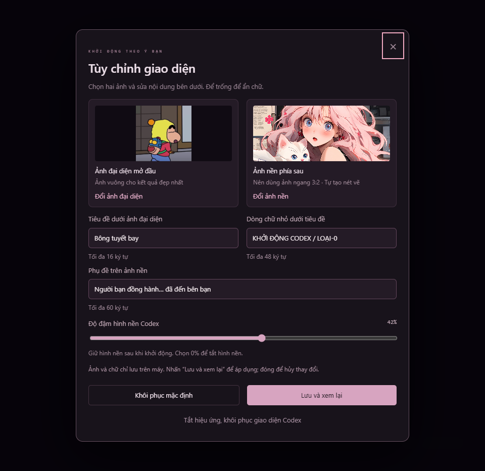

# Codex Startup Animation — Windows · Tiếng Việt

Hiệu ứng khởi động khoảng 12 giây ngay trong cửa sổ Codex, kèm hình nền tùy chỉnh và bảng cài đặt tiếng Việt. Đây là launcher bên ngoài, không phải plugin chính thức của OpenAI.

**[Tải bản Windows tiếng Việt](https://github.com/Nuttnee/codex-startup-animation/releases/latest)** · [Hướng dẫn đầy đủ](README-Windows.md) · [Repo gốc](https://github.com/panding999/codex-startup-animation) · [README gốc cho macOS](README-upstream.md)

## Bắt đầu nhanh

1. Trong trang Releases, tải **Codex-Startup-Windows-VI.zip** ở phần Assets (không cần tải Source code).
2. Nhấp phải ZIP → **Extract All / Giải nén tất cả** vào thư mục cố định, ví dụ `Documents\Codex-Startup-Windows`.
3. Lưu công việc và **thoát hẳn Codex**, kể cả biểu tượng trong khay hệ thống.
4. Mở thư mục vừa giải nén, nhấp đúp **Launch-Windows.cmd**. Không cần chạy bằng quyền quản trị.
5. Nhấn **Ctrl+Alt+B** để đổi ảnh, chữ và độ đậm hình nền. **Esc** để bỏ qua hiệu ứng.

Muốn chỉ xem thử: chạy **Preview-Windows.cmd**. Ảnh và chữ đã lưu ở bản xem thử không dùng chung với Codex.

## Có gì trong bản Windows?

- Tự tìm Codex desktop, dùng Node đi kèm ứng dụng; nếu không có thì dùng Node.js 22+ trên PATH.
- Kiểm tra chữ ký OpenAI và tiến trình sở hữu cổng gỡ lỗi trước khi gắn hiệu ứng.
- Không sửa thư mục cài đặt, không vá app.asar, không tự khởi động lại phiên đang làm việc.
- Chọn avatar, hình nền, tự tạo nét vẽ; tùy chỉnh tiêu đề, phụ đề và độ hiện hình nền.
- Giao diện, thông báo và nội dung mặc định của tiện ích bằng tiếng Việt. Không thay đổi ngôn ngữ giao diện chính của Codex.

## Tương thích và lưu ý

Đã kiểm thử với gói Windows x64 **OpenAI.Codex 26.1016.6573.0** (phiên bản ứng dụng trong owl-app.ini: **26.1016.51333**). Chưa bảo đảm mọi bản Windows/Codex; cập nhật ứng dụng có thể cần điều chỉnh launcher. Cần Windows PowerShell 5.1.

**Cổng gỡ lỗi cục bộ tồn tại trong suốt phiên Codex được mở bằng launcher.** Tiến trình khác trên máy có thể kết nối. Thoát hẳn Codex rồi mở từ biểu tượng chính thức để kết thúc chế độ này. Nút khôi phục giao diện chỉ gỡ trang trí.

Ảnh và chữ tùy chỉnh lưu trên máy bằng IndexedDB. Không có dịch vụ tải ảnh lên mạng. Tải lại trang hoặc mở cửa sổ mới có thể làm mất hiệu ứng vì launcher không thường trú để gắn lại.

## Hướng dẫn và kiểm thử

Xem **[README-Windows.md](README-Windows.md)** để biết cách tạo shortcut, cập nhật, khôi phục, gỡ bỏ, xử lý lỗi và tự đóng gói.

Đã chạy 7 kiểm tra tự động và kiểm thử trên ứng dụng thật với hồ sơ giao diện riêng: animation hoàn tất, lớp phủ được gỡ, hình nền giữ lại, Ctrl+Alt+B mở cài đặt và khôi phục giao diện hoạt động. Không đưa hồ sơ thử nghiệm hoặc ảnh chụp chứa nội dung trò chuyện vào repo/gói tải.

## Nguồn và quyền sử dụng

Fork từ [panding999/codex-startup-animation](https://github.com/panding999/codex-startup-animation), dựa trên commit `c743c2b5eceaa7be9dc511d23a1a77f7c4ce6248`. Phần animation, hình ảnh và cơ chế lớp phủ kế thừa repo gốc; bản fork bổ sung Windows và Việt hóa. Xem [tham khảo của tác giả](docs/references.md).

Repo gốc chưa chỉ định giấy phép mã nguồn; bản fork không tự cấp lại giấy phép cho mã hoặc hình ảnh gốc. Quyền hình ảnh thuộc các chủ sở hữu tương ứng. Dự án không có quan hệ liên kết chính thức với OpenAI. Hướng dẫn macOS gốc được giữ trong README-upstream.md; bản fork này tập trung kiểm thử Windows.
